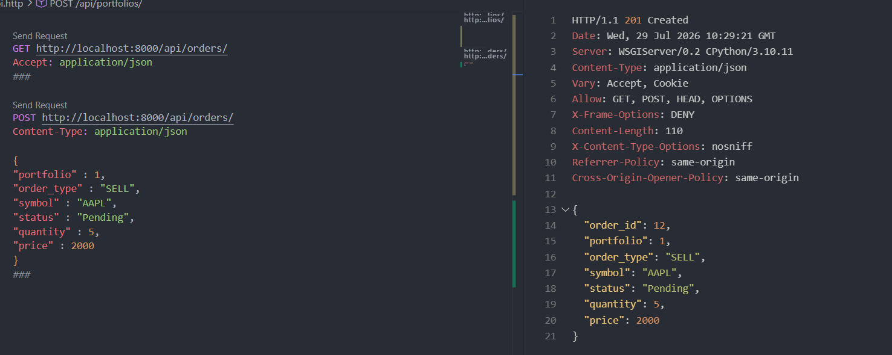
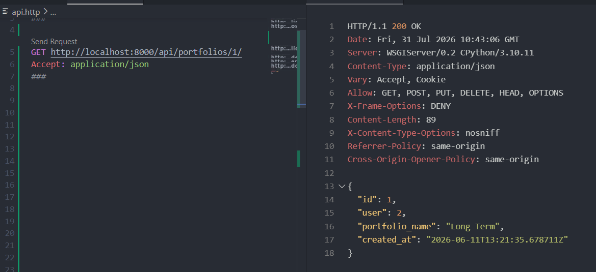
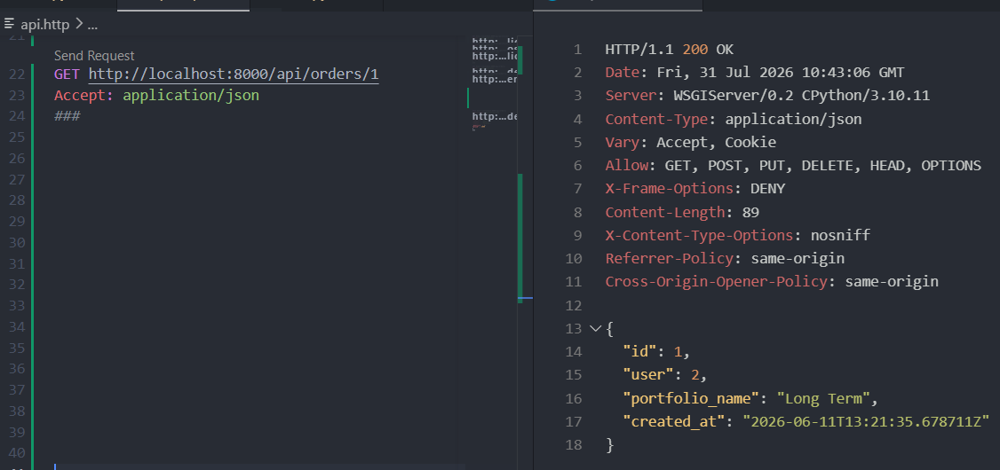
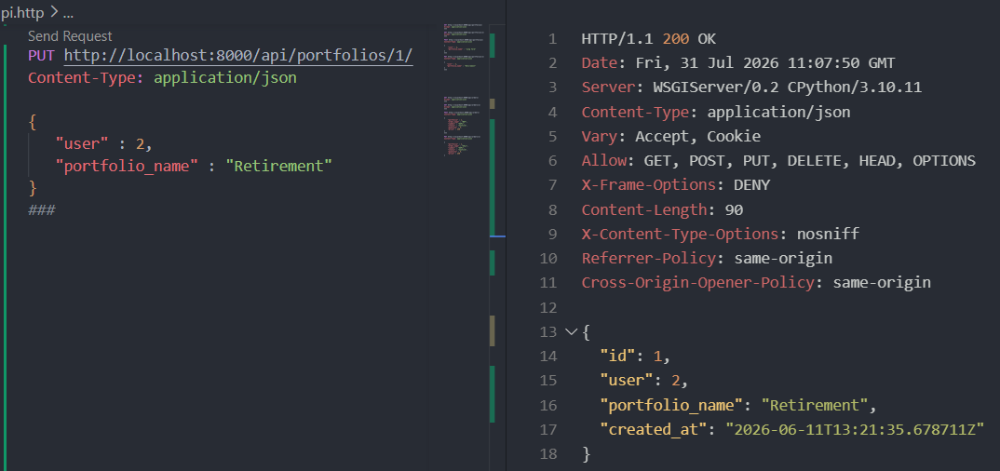
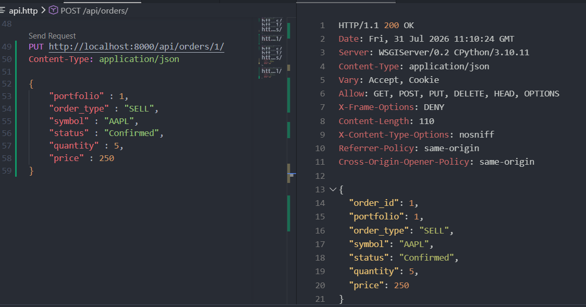
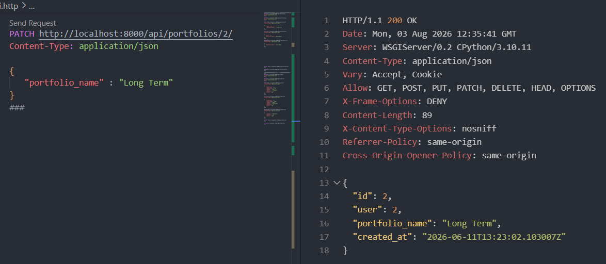
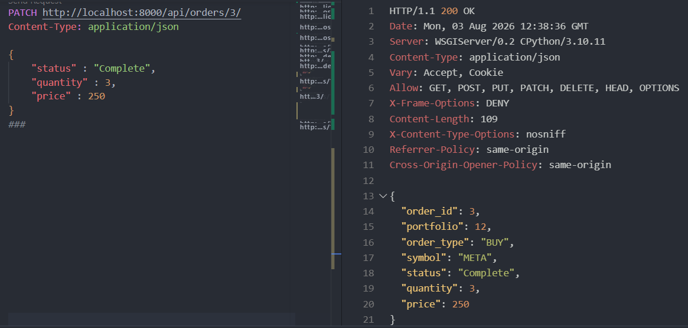
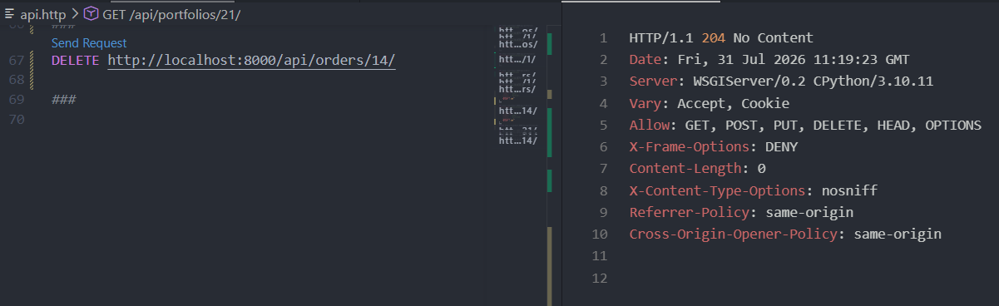

### Day 10: CRUD operations with APIView class: code, testing, flow

CRUD - Create Read Update Delete
     - represents the four basic operations performed on database records through an API.

| Operation | HTTP Method | Purpose                        |
| --------- | ----------- | ------------------------------ |
| Create    | POST        | Add a new resource             |
| Read      | GET         | Retrieve one or more resources |
| Update    | PUT / PATCH | Modify an existing resource    |
| Delete    | DELETE      | Remove a resource              |

1) Create - POST method
Creates a new resource by validating request data through a serializer and saving it to the database.
```python
def post(self, request):
    serializer = PortfolioSerializer(data=request.data)
    if serializer.is_valid():
        serializer.save()
        return Response(serializer.data, status=status.HTTP_201_CREATED)
    return Response(serializer.errors, status=status.HTTP_400_BAD_REQUEST)
```

Testing:



Flow:
```
Client JSON
      ↓
request.data
      ↓
Serializer(data=...)
      ↓
is_valid()
      ↓
save()
      ↓
Response(serializer.data)
```

2) READ - GET method
Retrieves resource(s) from the database, serializes them, and returns them as JSON.
```python
def get(self, request, pk=None):
    if pk is not None:
        queryset = self.get_object(pk)
        serializer = PortfolioSerializer(queryset)
    else:           
        queryset = Portfolio.objects.all()
        serializer = PortfolioSerializer(queryset, many=True)

    return Response(serializer.data)
```
Testing portfolio id=1:


Testing order id=1:


Flow of code for value of `pk`:
```
pk=None
GET /orders/
        ↓
TradeOrder.objects.all()
        ↓
many=True
```
```
pk=1
GET /orders/1/
        ↓
TradeOrder.objects.get(pk=1)
        ↓
single serializer
```

3) Update - PUT & PATCH method 
```
PUT → all required fields should be provided (full update).
PATCH → only the fields you want to change are required (partial update).
```
PUT :- Updates an existing resource by validating new data and saving the changes.
```python
def put(self, request, pk):
    queryset = self.get_object(pk)
    serializer = TradeOrderSerializer(queryset, data=request.data)
    if serializer.is_valid():
        serializer.save()
        return Response(serializer.data)
    return Response(serializer.errors, status=status.HTTP_400_BAD_REQUEST)
```

Testing:




FLow:
```
URL (pk)
      ↓
Retrieve object
      ↓
Serializer(instance, data=request.data)
      ↓
is_valid()
      ↓
save()
      ↓
Response(updated data)
```

PATCH (Partial Update):-
Updates only the specified fields of an existing resource without requiring all fields.
```python
def patch(self, request, pk):
    queryset = self.get_object(pk)
    serializer = TradeOrderSerializer(queryset, data=request.data, partial=True)
    if serializer.is_valid():
        serializer.save()
        return Response(serializer.data)
    return Response(serializer.errors, status=status.HTTP_400_BAD_REQUEST)
```
Testing:




Flow:
```
URL (pk)
      ↓
Retrieve object
      ↓
Serializer(instance, data=request.data, partial=True)
      ↓
is_valid()
      ↓
save()
      ↓
Response(updated data)
```

4) Delete - DELETE method
Removes an existing resource from the database and returns a success response.
```python
def delete(self, request, pk):
    queryset = self.get_object(pk)
    queryset.delete()
    return Response(status=status.HTTP_204_NO_CONTENT)
```

Testing:




Flow:
```
URL (pk)
      ↓
Retrieve object
      ↓
delete()
      ↓
Return success response
```
