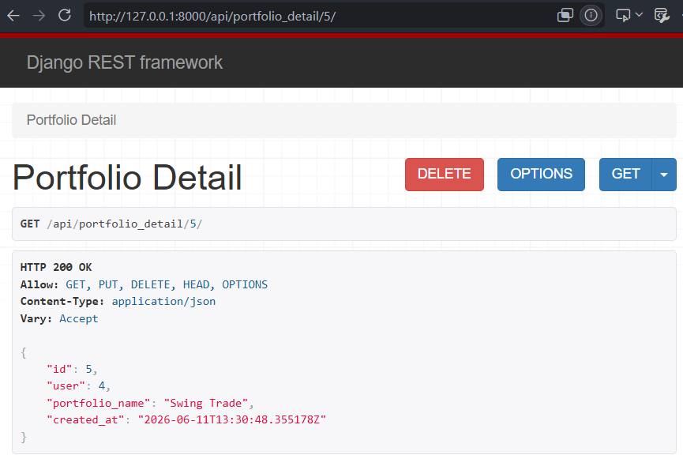

### Day : Generic Views

The view is the bridge between the HTTP world and your application logic.

Generic Views allows to quickly build API views that map closely to database models.

#### **GenericAPIView:**
- GenericAPIView extends APIView by providing common functionality needed for CRUD operations, such as handling querysets, serializers, object lookup, pagination, and filtering.  
- Concrete Generic Views (e.g., ListCreateAPIView) are built by combining GenericAPIView with one or more mixins.
```
GenericAPIView doesn't perform CRUD by itself—it provides the common building blocks. Mixins add the actual CRUD behavior.
```

#### *Attributes:*
*Basic Settings:*
1) queryset - Fixed queryset used by the view.
Override get_queryset() when the queryset should change dynamically.
2) serializer_class - Specifies which serializer the view should use.
3) lookup_field - Model field used to retrieve a single object.
Default: pk.
4) lookup_url_kwarg - URL parameter used for object lookup.
Default: same as lookup_field.

*Pagination:*
pagination_class - Controls how list results are divided into pages.
Set to `None` to disable pagination.

*Filtering:*
filter_backends - Specifies the filtering classes used to filter the queryset.
Works with query parameters (e.g., search, ordering, filtering).

#### *Methods:*
Base methods:
get_queryset() → Override when the queryset depends on the request, user, URL parameters, or other runtime conditions.

Example 1: Logged-in user
```python
def get_queryset(self):
    return Portfolio.objects.filter(user=self.request.user)
```
Now each user sees only their portfolios.

Example 2: URL parameter
```python
def get_queryset(self):
    return TradeOrder.objects.filter(portfolio_id=self.kwargs["pk"])
```
Now the queryset depends on the URL.

Example 3: Query parameter
```python
GET /api/orders/?status=Pending
def get_queryset(self):
    status = self.request.query_params.get("status")
    return TradeOrder.objects.filter(status=status)
```

*Avoiding N+1 queries:* Optimize querysets, especially when serializers access related objects in list views.
DRF recommends:
select_related() → follows ForeignKey/OneToOne relationships using a SQL JOIN to avoid extra queries.  
- used to fetch related objects in the same query
                
```powershell
>>> from trade_app.models import Portfolio
>>> pf = Portfolio.objects.select_related("user")
>>> for p in pf:
...     print(p.portfolio_name, p.user.username)
... 
Long Term Jerry
Swing Trades Jerry
......
```
```
select_related
    ↓
FK / OneToOne
    ↓
SQL JOIN
```

prefetch_related() → fetches related objects separately and combines them in Python; useful for ManyToMany and reverse relationships.  
- used to efficiently load collections of related objects:
```powershell
>>> from trade_app.models import Portfolio, TradeOrder
>>> pf = Portfolio.objects.prefetch_related("tradeorder_set")
>>> for p in pf:
...     print(p.portfolio_name, list(p.tradeorder_set.all()))
... 
Long Term [<TradeOrder: BUY-AAPL-Pending>]
Swing Trades []
Long Term []
Swing Trade [<TradeOrder: SELL-MSFT-Complete>]
Swing Trade [<TradeOrder: SELL-NFLX-Pending>]
Swing Trade [<TradeOrder: SELL-MSFT-Complete>]
Swing Trade [<TradeOrder: BUY-AAPL-Complete>, <TradeOrder: SELL-AMD-Complete>]
Long Term [<TradeOrder: BUY-AMZN-Pending>]
Long Term []
Long Term []
Growth ptf [<TradeOrder: BUY-META-Complete>]
Growth ptf [<TradeOrder: BUY-NVDA-Confirmed>]

>>> from django.db import connection
>>> len(connection.queries)         
2
```
With prefetch:
1 query → portfolios
1 query → all related orders
──────────────────────────────
2 queries

```powershell
>>> for p in Portfolio.objects.all():
...     print(p.portfolio_name, list(p.tradeorder_set.all()))
... 
Long Term [<TradeOrder: BUY-AAPL-Pending>]
Swing Trades []
Long Term []
Swing Trade [<TradeOrder: SELL-MSFT-Complete>]
Swing Trade [<TradeOrder: SELL-NFLX-Pending>]
Swing Trade [<TradeOrder: SELL-MSFT-Complete>]
Swing Trade [<TradeOrder: BUY-AAPL-Complete>, <TradeOrder: SELL-AMD-Complete>]
Long Term [<TradeOrder: BUY-AMZN-Pending>]
Long Term []
Long Term []
Growth ptf [<TradeOrder: BUY-META-Complete>]
Growth ptf [<TradeOrder: BUY-NVDA-Confirmed>]
Retirement ptf []
Retirement ptf [<TradeOrder: BUY-TSLA-Pending>]
>>> len(connection.queries)          
22
```
Without prefetch:
1 query → portfolios
21 queries → orders for each portfolio
──────────────────────────────
22 queries
```
prefetch_related
    ↓
ManyToMany / reverse relationships
    ↓
separate query + Django combines results
```
```
tradeorder_set
     │
     ├── no prefetch → query every time → N+1
     │
     └── prefetch_related() → fetch efficiently → 2 queries
```

**generics.GenericAPIView methods**
| Method             | Basic job                                             |
| ------------------ | ----------------------------------------------------- |
| `get_queryset()`   | Get the objects this view should work with            |
| `get_serializer()` | Create the appropriate serializer instance            |
| `get_object()`     | Find **one specific object** for detail/update/delete |


**Mixins**
The mixins contain the actual reusable CRUD operation:

ListModelMixin      → list()
CreateModelMixin    → create()
RetrieveModelMixin  → retrieve()
UpdateModelMixin    → update()
DestroyModelMixin   → destroy()


***************************************************************************
### Code snippets

1) Added GenericAPIView for pf
```python
class PortfolioView1(GenericAPIView):
    queryset = Portfolio.objects.all()
    serializer_class = PortfolioSerializer
   
    def get(self, request):
        queryset = self.get_queryset()
        serializer = self.get_serializer(queryset, many=True)
        return Response(serializer.data)
```

Added urlpattern `path('portfolio_detail/<int:pk>/', PortfolioDetailView.as_view()),`



2) added Mixins to pf1
```python
class PortfolioView1(GenericAPIView, 
                     mixins.ListModelMixin, 
                     mixins.CreateModelMixin):
    queryset = Portfolio.objects.all()
    serializer_class = PortfolioSerializer
      
    def get(self, request, *args, **kwargs):
        return self.list(request, *args, **kwargs)

    def post(self, request, *args, **kwargs):
        return self.create(request, *args, **kwargs)
```


3) Added detail view of pf with generic.GenericAPIView and Mixins
```python
class PortfolioDetailView(GenericAPIView, 
                          mixins.RetrieveModelMixin,
                          mixins.UpdateModelMixin,
                          mixins.DestroyModelMixin):
    queryset = Portfolio.objects.all()
    serializer_class = PortfolioSerializer

    def get(self, request, *args, **kwargs):
        return self.retrieve(request, *args, **kwargs)

    def put(self, request, *args, **kwargs):
        return self.update(request, *args, **kwargs)

    def delete(self, request, *args, **kwargs):
        return self.destroy(request, *args, **kwargs)
```

added urlpattern `path('portfolios1/', PortfolioView1.as_view()),` in urls.py

Testing:


***************************************************************************
List View → GET (retrieve a collection of objects)
Create View → POST (create a new object)
Retrieve View → GET (retrieve a single object)
Update View → PUT / PATCH
Destroy View → DELETE


