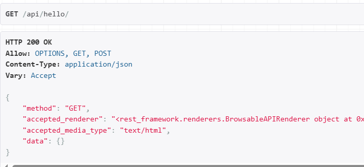
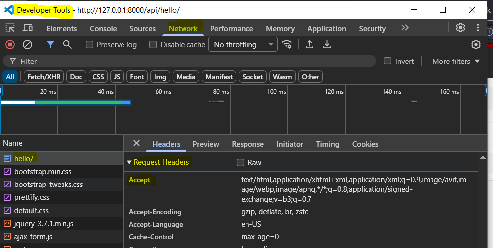
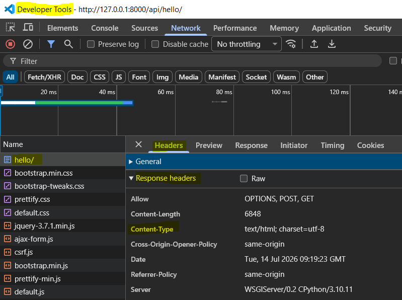

### Day 8: Renderer
A renderer converts a `Response` object into the final HTTP response format (e.g., JSON or HTML).

#### How Renderer is determined ?/Renderer Selection
DRF selects a renderer using content negotiation based on the client's `Accept` header.
```python
"accepted_renderer": str(request.accepted_renderer),
"accepted_media_type": request.accepted_media_type,
```

- In the DRF Browsable API, `accepted_media_type` is typically `text/html` because the browser requests an HTML response.

#### Setting Renderer
1) Default Global Project Setting:
```python
REST_FRAMEWORK = {
    'DEFAULT_RENDERER_CLASSES': [
        'rest_framework.renderers.JSONRenderer',
        'rest_framework.renderers.BrowsableAPIRenderer',
    ]
}
```

2) In `views.py/APIView class-based view`  
```python
renderer_classes = [JSONRender]
```

3) or using @api_view decorator with function-based view  
```python
@api_view(['GET'])
@renderer_classes([JSONRenderer])
def func_view(): ...
```

**NOTE:**  
*Ordering of renderer class:* If the client does not specify an `Accept` header, DRF uses the first renderer in the configured renderer list.

**`Accept` Header seen in DevTools of `api/hello` endpoints**  
in request: 


in response:


#### Renderer Types:
**JSONRenderer**
- Renders the response as JSON.
- Commonly used for REST APIs.
- attributes of renderer are:
```
.media_type: application/json
.format: 'json'
.charset: None
```

**BrowsableAPIRenderer**
- Renders an interactive HTML page for exploring and testing APIs in the browser.
- Uses `JSONRenderer` by default to display response data.
- Can be customized by overriding its templates.
```python
class CustomBrowsableAPIRenderer(BrowsableAPIRenderer):
    def get_default_renderer(self, view):
        return JSONRenderer()
```
- attributes of renderer are:
```
.media_type: text/html
.format: 'api'
.charset: utf-8
.template: 'rest_framework/api.html'
```
**Other Renderers**
- DRF also provides renderers for HTML and other response formats.
- Custom renderers can be created when a different output format is required.


***Flow:***
```
HTTP Request
      ↓
APIView
      ↓
Request
      ↓
Serializer
      ↓
Response
      ↓
Renderer (.render())
      ↓
Rendered Content (JSON / HTML)
      ↓
HTTP Response
```