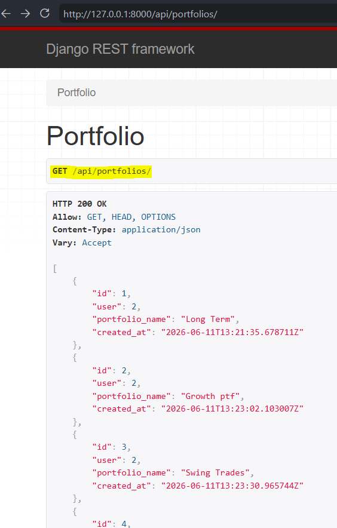
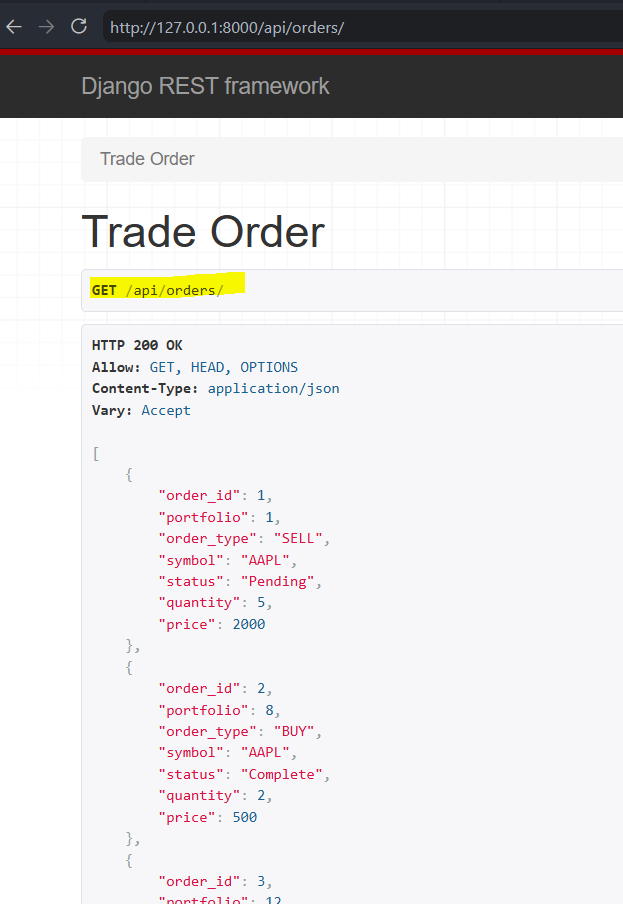
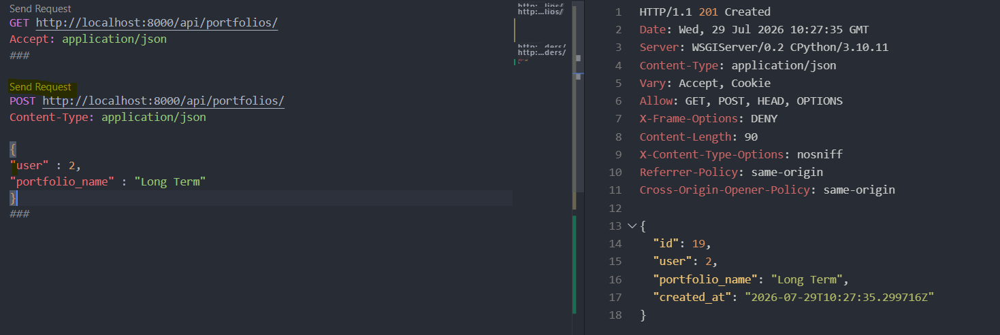
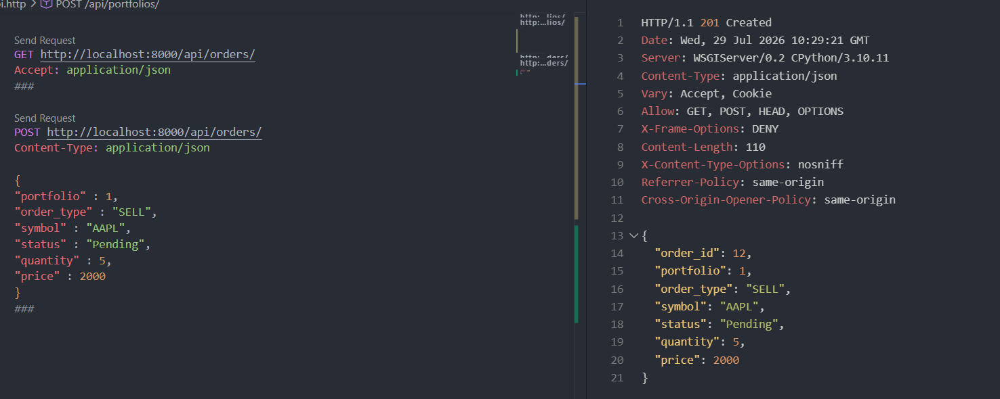

Day 9: Created First api endpoints - GET & POST

***GET api/endpoint/***
1) Create Class-based Views PortfolioView and TradeOrderView to `GET` all Portfolios and Trade Orders
2) Added urlpattern to `trade_app/urls.py`

**Testing:**
/api/portfolios:


/api/orders:


```
HTTP GET
   ↓
APIView.get()
   ↓
QuerySet
   ↓
ModelSerializer(queryset, many=True)
   ↓
Response(serializer.data)
   ↓
JSON
```


***POST api/endpoint/***
Added post() method to views.py
```python
def post(self, request):
        serializer = PortfolioSerializer(data=request.data)
        if serializer.is_valid():
            serializer.save()
            return Response(serializer.data, status=status.HTTP_201_CREATED)
        return Response(serializer.errors, status=status.HTTP_400_BAD_REQUEST)
```
Similar for Trade Order with necessary changes in above.

Testing POST request on Portfolio n orders in api.http: 






